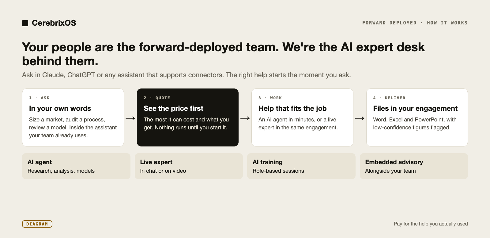
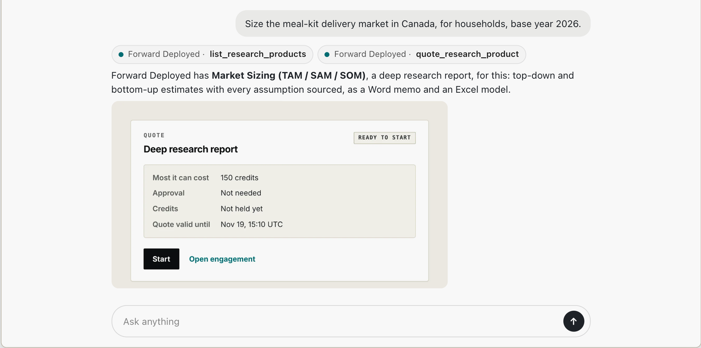
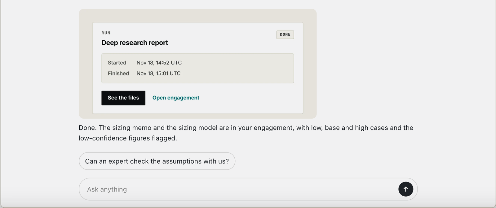
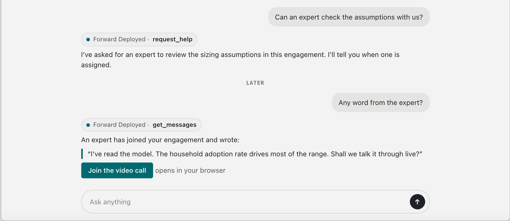

# CerebrixOS (Forward Deployed) MCP Server

**Your people are the forward-deployed team. We're the AI expert desk behind them, inside Claude, ChatGPT or any AI assistant.**

Ask for strategy, finance, technology or AI help in your own words. You get the help the task needs: an AI agent, a live expert, training, or an advisor working alongside your team. You see what a job can cost before anything runs.

**Website:** [cerebrixos.com](https://cerebrixos.com) ·
**Connect:** [forwardeployed.work/connect](https://forwardeployed.work/connect) ·
**Privacy:** [cerebrixos.com/privacy](https://cerebrixos.com/privacy) ·
**Support:** support@cerebrixos.com

## Connect

Hosted connector, nothing to install:

```text
https://forwardeployed.work/mcp
```

Add it as a custom connector in Claude, sign in with your work email and ask. In Claude Code:

```bash
claude mcp add --transport http cerebrixos https://forwardeployed.work/mcp
```

## Images

Taken from the click-through demo on cerebrixos.com (illustrative conversation, demo data). The diagram is an illustration.

| | |
| --- | --- |
|  |  |
|  |  |

Part of Forward Deployed Solutions from CerebrixOS (Ockham Labs Inc.).
