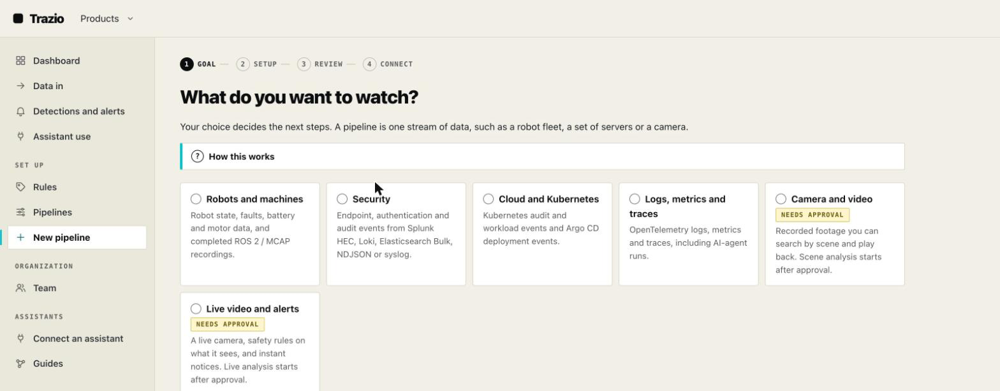
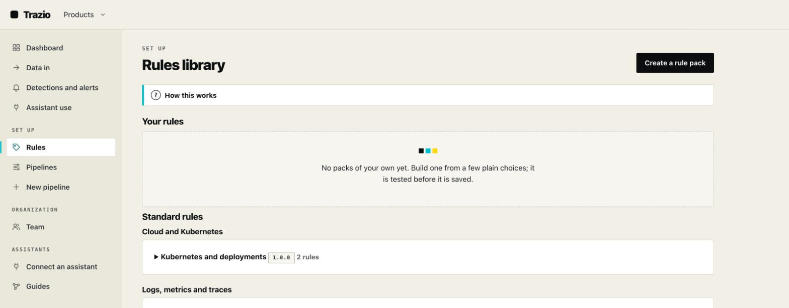
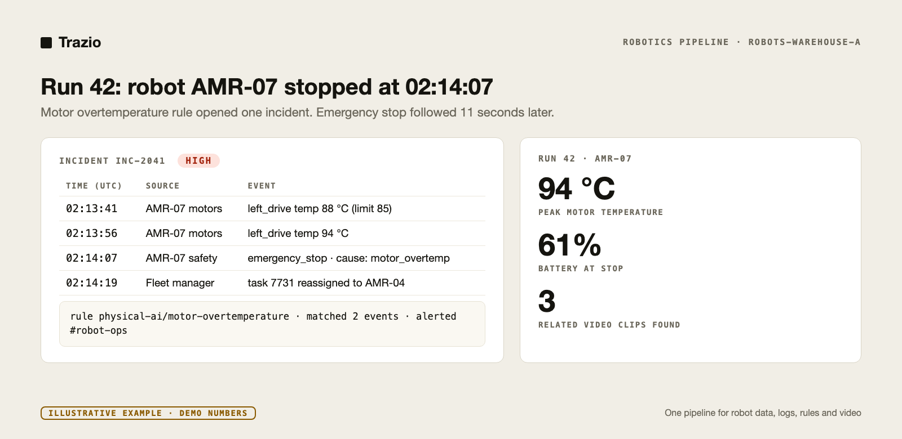
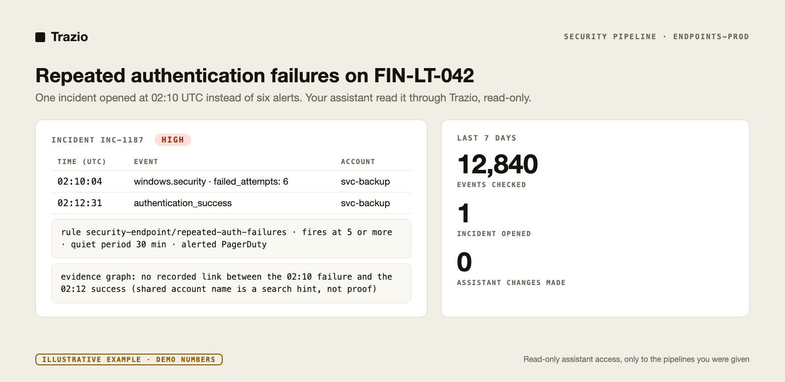
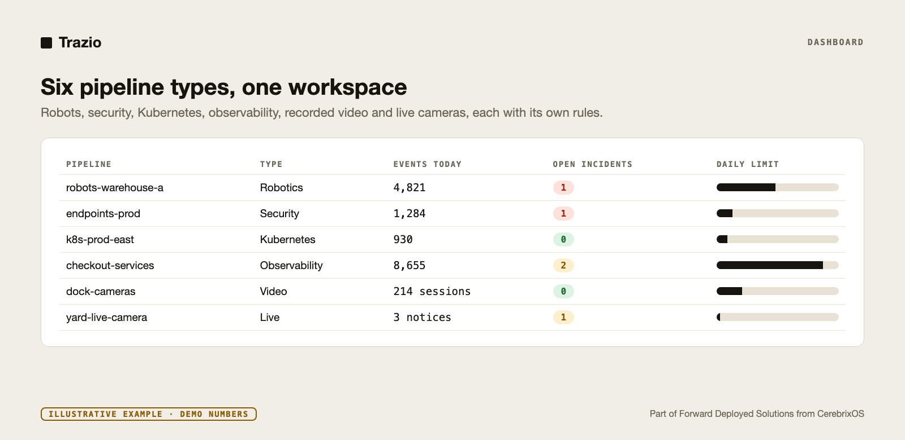

# Trazio MCP Server

**Ask Claude, ChatGPT or any MCP client what happened in your logs, security events, robot runs and video.**

Trazio is an alternative to Datadog, Splunk, New Relic, Elastic and Cribl: one pipeline for logs, metrics, traces, security events, robot data and video, stored in the United States or Canada, at a fraction of the cost. The Trazio MCP server lets an AI assistant read your pipelines and answer "what happened?" with the evidence. Access is read-only.

**Website:** [trazio.cerebrixos.com](https://trazio.cerebrixos.com) ·
**Docs:** [trazio.cerebrixos.com/docs](https://trazio.cerebrixos.com/docs) ·
**Privacy:** [trazio.cerebrixos.com/privacy](https://trazio.cerebrixos.com/privacy) ·
**Support:** support@cerebrixos.com

> You need a Trazio workspace to use this server. A free trial gives you 3 pipelines at 10,000 events a day each.
> [Get started](https://trazio.cerebrixos.com).

## Connect

Hosted connector, nothing to install:

```text
https://trazio.cerebrixos.com/mcp
```

Add it as a custom connector in Claude or ChatGPT, choose **Continue with CerebrixOS** and sign in. In Claude Code:

```bash
claude mcp add --transport http trazio https://trazio.cerebrixos.com/mcp
```

Each connection is limited to the pipelines the signed-in person was given, is read-only, and expires on its own.

## Six pipeline types

| Pipeline | For | Example question |
| --- | --- | --- |
| Robotics | Robot state, faults, battery and motor data, MCAP, ROS bags, CAN logs | Why did the robot stop during run 42? |
| Security | Endpoint, authentication and audit events | What happened with the open incident on endpoints-prod? |
| Kubernetes | Kubernetes audit and Argo CD events | Who created the privileged workload? |
| Observability | OpenTelemetry logs, metrics, traces and AI runs | Which services have a high error rate right now? |
| Video | Recorded footage, searchable by description | Find the moment a forklift gets close to a worker. |
| Live | A live camera with safety rules and instant notices | What did it see before the alert? |

Video and Live need approval from the Trazio team before analysis starts.

## Screenshots

The first two are from the live console. The three marked "illustrative" use demo numbers.

| | |
| --- | --- |
|  |  |
|  |  |
|  | |

See [TOOLS.md](TOOLS.md) for the full tool list.

## Safe by design

- Every request is limited to the signed-in person's own workspace and pipeline. Tenant and pipeline scope are never tool arguments.
- Assistants can't send data, change settings or delete anything. The one write-type tool, `request_video_export`, creates a bounded video clip when an admin has enabled exports.
- Data tokens can only send data, never read it.

Trazio is part of Forward Deployed Solutions from CerebrixOS (Ockham Labs Inc.).
